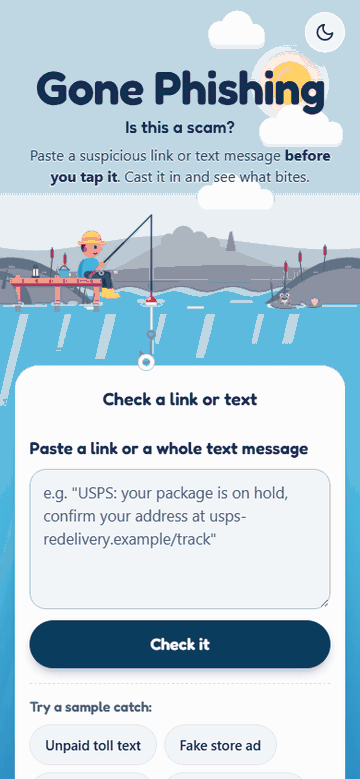
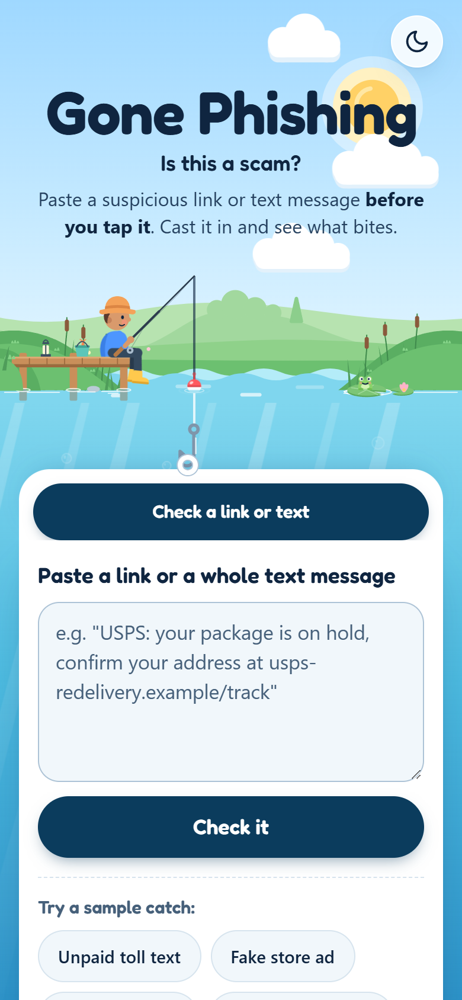
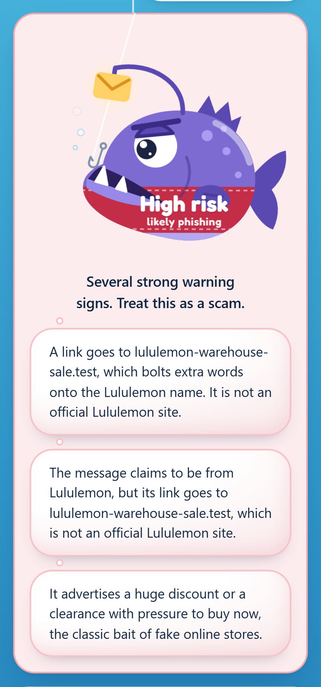
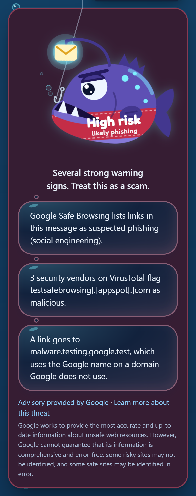
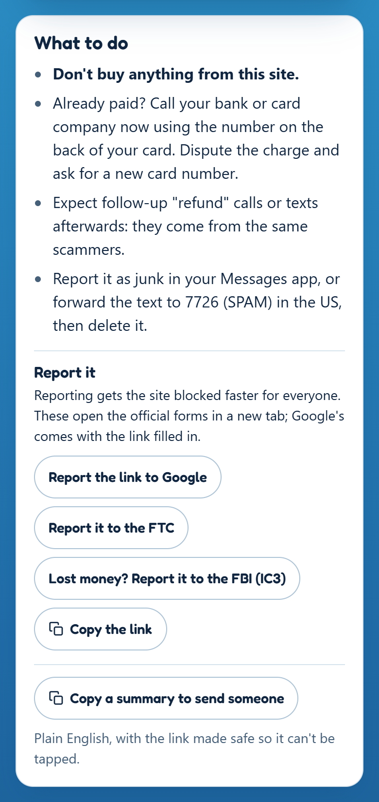
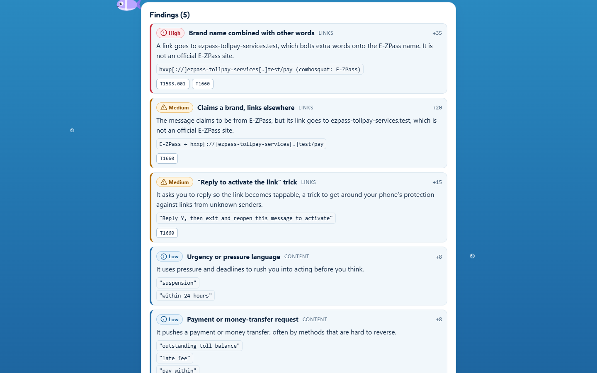
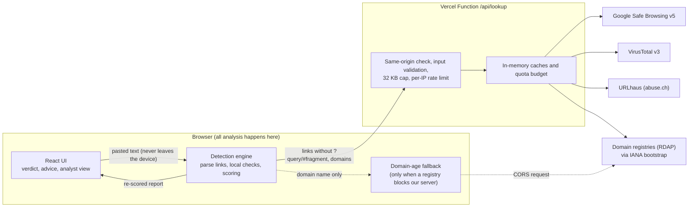

# Gone Phishing

**Live: [phishing-triage-tool.vercel.app](https://phishing-triage-tool.vercel.app)**

Paste a suspicious link or text message *before you tap it* and get a clear, explainable verdict: what's wrong with it, in plain English, and what to do next. Everything is analyzed in your browser. Only links and domains are looked up online, and the tool never opens a link.

<p align="center"></p>

The demo uses a real fake store that took a friend's card details at checkout in October 2026. No blocklist knew it yet. The tool catches it from the brand misspelling, the cheap `.shop` ending and the domain age, which comes from a live registry lookup (24 days old).

| Landing page | The catch | A real Google Safe Browsing hit (night) |
| --- | --- | --- |
|  |  |  |

| What to do | Analyst view (desktop) |
| --- | --- |
|  |  |

## What it does

- **One box.** Paste a link or a whole text message, or try one of the five samples: toll text, fake store ad, wrong-number opener, a Google Safe Browsing test page, and an ordinary text that should come back clean.
- **A verdict you can read.** "High risk", "Suspicious" or "No red flags found" is painted on the fish's band, with the two or three most useful reasons as bubbles. "No red flags" never means "safe".
- **Advice that fits the scam.** A fake store says "don't buy; if you already paid, call your bank and dispute the charge". A toll text says "toll agencies don't collect by text", and so on for delivery, sign-in, callback-number and wrong-number scams.
- **Report it in one tap.** Official forms open in a new tab: Google Safe Browsing (with the link pre-filled), the FTC, and the FBI's IC3 for scams that can cost money.
- **Send it to someone.** "Copy a summary to send someone" gives a plain-English summary. Every link in it is defanged so the other person's phone can't make it tappable.
- **Analyst view.** Every finding with its weight, severity, evidence and MITRE ATT&CK techniques, plus a links table, defanged IOCs, JSON export and a Markdown ticket summary.
- **Day or night.** It opens in day mode, with a night-fishing toggle that is remembered. The brief asked for dark by default; day was chosen in design review because it suits the cartoon pond.

## Architecture



- **Frontend:** Vite, React 19 and TypeScript, with no UI framework and hand-drawn SVG art. The detection engine is lazy-loaded, so the landing page paints first.
- **Backend:** a single Vercel Function, `/api/lookup`. It exists only because the reputation providers need secret API keys. It asks providers *about* indicators and **never fetches a submitted URL**: no request, no redirect-following.
- **Two-pass verdict.** The local verdict shows immediately. The online results arrive a moment later and re-score the same report, so a Safe Browsing hit or a brand-new domain can upgrade the verdict.
- **Dependencies:** four at runtime: `react`, `react-dom`, `tldts` (Public Suffix List parsing) and `@fontsource-variable/fredoka`. `postal-mime` is used by the paused email analyzer (see below).

## Detection logic and scoring

Every weight and threshold lives in [`src/engine/config.ts`](src/engine/config.ts).

### How the score works

- **Score:** the sum of the weights of *distinct* findings. A check that fires on five links counts once.
- **Verdict:** 25+ is **Suspicious**, 60+ is **High risk**.
- **Content cap:** wording signals (urgency, payment, "sign in to verify", huge discounts, generic greetings) are weak on their own, so together they add at most **20**.
- **Known-bad forces High:** a hit from Safe Browsing, URLhaus or 2+ VirusTotal engines makes the verdict High whatever the score.
- **Severity labels:** High (weight 30+), Medium (12+) or Low. Each label carries an icon and text as well as a color, so color is never the only signal.

### Links

| Check | Weight | Example |
| --- | --- | --- |
| Lookalike domain (homoglyphs, typos) | 40 | `paypa1-login`, `summrfrideays` |
| Brand combined with other words | 35 | `ezpass-tollpay-services` |
| Brand hidden in a subdomain | 35 | `usps.com-redelivery.test` |
| Link text doesn't match destination | 30 | shows `paypal.com`, goes elsewhere |
| Script or data link | 30 | `javascript:`, `data:` |
| Brand name on an unofficial domain | 25 | `google.test` |
| Raw IP address | 25 | `http://203.0.113.77/usps` |
| Text-direction trick (right-to-left override) | 25 | hidden `U+202E` inside a link |
| "Claims a brand, links elsewhere" | 20 | text says E-ZPass, link isn't theirs |
| `@` trick, embedded form | 20 | `https://paypal.com@evil.test` |
| Page on a free website or form builder | 15 | `*.pages.dev`, Google Forms asking you to "verify" |
| Login-style page over plain HTTP | 15 | `http://…/login` |
| "Reply to activate the link" trick | 15 | iMessage link-unlock trick |
| Hidden zero-width characters | 12 | `pay​pal` |
| Redirect parameter to another site | 12 | `?url=https://…` |
| URL shortener (destination hidden) | 10 | `bit.ly/…` |
| Punycode domain, excessive subdomains, risky ending | 10, 8, 8 | `xn--…`, `.shop`, `.top`, `.xyz` |

The lookalike checks compare domains against **~50 commonly impersonated brands**: banks, delivery companies, toll agencies, big tech, and retailers copied by fake stores. They use confusable-character normalization and edit distance. Short brand names only match whole words, so "pineapple" never matches Apple.

### Texts without a link

| Check | Weight |
| --- | --- |
| "Wrong number" opener ("Hi, is this Emily?"), the start of investment and romance scams | 25 |
| Asks you to call a number about an account or charge | 20 |

### Online reputation and domain age

| Signal | Weight |
| --- | --- |
| Google Safe Browsing match | 50, forces High |
| URLhaus exact URL match | 50, forces High |
| VirusTotal: 2+ engines say malicious (and community reputation below 100) | 45, forces High |
| VirusTotal: 1 engine | 20 |
| Domain registered in the last 30 days (90 days for cheap endings like `.shop`) | 30 |

Two thresholds are there because false positives turned up during testing. `google.com` has one stray "malicious" vote on VirusTotal, so domains with a high community reputation ignore lone votes. URLhaus lists `github.com` as a host that has served malware, so only **exact URL matches** count, never whole-host listings.

## Privacy

- **What leaves the browser:** web links with their `?query` and `#fragment` removed, plus their registrable domains. At most 25 of each are sent, most suspicious first. The message text never leaves the device.
- **Why strip queries:** query strings often carry personal tokens, such as password-reset links, tracking IDs and the recipient's email address. The trade-off is that a phishing page identified only by its query string may be missed. The same rule applies to the Google report link.
- **A visible switch.** The privacy note under the input states exactly what is sent and has an **online checks on/off** switch. With it off, nothing leaves the device.
- **The domain-age fallback.** Some registries block cloud servers (the `.shop` registry answers Vercel with HTTP 429 every time). When that happens, the browser asks that registry directly for the domain's registration date. Only the domain name is sent. The CSP allows exactly those 17 registry hosts.
- **No storage, no logging.** Nothing submitted is stored or logged on the server. Responses are `Cache-Control: no-store`. The browser keeps lookup results for 5 minutes, in memory only.

## Security of the app itself

| Control | How |
| --- | --- |
| Content-Security-Policy | `default-src 'self'`, no inline scripts or styles, no third-party scripts, `connect-src 'self'` plus the 17 RDAP registries, `object-src 'none'`, `base-uri 'none'`, `form-action 'none'`, `frame-ancestors 'none'` |
| Other headers | HSTS (2 years, preload), `nosniff`, `Referrer-Policy: no-referrer`, `X-Frame-Options: DENY`, COOP `same-origin`, Permissions-Policy denying camera, microphone, geolocation, payment and USB |
| Verified | [Mozilla Observatory](https://developer.mozilla.org/en-US/observatory/analyze?host=phishing-triage-tool.vercel.app): **A+ (130/130, 12/12 tests)**. Lighthouse (mobile): **Performance 96, Accessibility 100, Best Practices 100, SEO 100** (October 14, 2026) |
| No SSRF | The server never requests a user-supplied URL; it only calls four fixed provider hosts |
| API abuse | Same-origin only (`Origin` and `Sec-Fetch-Site`), strict validation (http/https URLs, domains and SHA-256 hashes only), 32 KB body cap, per-provider timeouts, per-IP limit of 30/min and 300/hour |
| Provider quotas | VirusTotal's 4/min and 500/day public quota is budgeted on the server: hashes first, then domains, then at most 2 URLs. Results are cached (Safe Browsing within Google's limits of 30 min for hits and 1 h for misses, URLhaus 30 min, VirusTotal 6–12 h, RDAP 24 h). When a limit is hit, the tool says so ("VirusTotal limit reached, try again in a minute") |
| Safe rendering | Nothing from the input is ever rendered as HTML; every displayed value is escaped by React. IOC exports and ticket summaries are defanged and Markdown-escaped |
| Secrets | API keys live only in Vercel environment variables, never with a `VITE_` prefix, so they're never shipped to the browser. `.env*` is gitignored except `.env.example`. A scan of the full git history finds no keys |
| Supply chain | `npm audit`: 0 vulnerabilities. Dependabot is configured for npm and GitHub Actions |

## Threat model

**What the tool trusts:**
- the four providers' answers, with stated limits
- the domain registries' registration dates
- its own code, served under a strict CSP

**What it deliberately doesn't trust:**
- **Anything in the pasted text.** Link text, brand names and phone numbers are all attacker-controlled. Display text is compared with the real destination, never believed.
- **Reputation feeds as proof of safety.** Blocklists lag days behind brand-new phishing sites. The fake store in the demo was on none of them. A clean reputation result never lowers the score; only local evidence and domain age can catch day-zero sites.
- **The heuristics themselves.** They can false-positive. Every finding explains itself and shows its evidence, so a person can disagree, and "No red flags found" is never worded as "safe".

**Why links are never visited:**
- **Tipping off the attacker.** Visiting a phishing link confirms the target is active.
- **One-click tokens.** It can trigger tracking or one-click tokens, like "unsubscribe" or account confirmations.
- **SSRF.** Server-side fetching would turn the tool into a request forwarder.
- **Malicious content.** It could expose the server to whatever the page serves.

The trade-off is that shortened links can't be expanded. The tool says the destination is hidden.

**Abuse of the tool itself.** The lookup API is the only server surface. It accepts only validated indicators from same-origin pages, rate-limits per IP, and has nothing to store or leak. The in-memory rate limiter is per server instance, so the limit is approximate when Vercel scales out. That's acceptable for a portfolio project; a shared store such as Upstash Redis would make it exact.

## Email analysis (paused)

The brief included full email analysis: SPF, DKIM and DMARC from `Authentication-Results`, the `Received` relay chain, sender lookalikes, attachments with magic-byte sniffing, and .eml parsing with `postal-mime`. That engine is built and tested: 4 synthetic samples, forged-header detection, and recognition of organizations' email gateways (Proofpoint, Mimecast and others in front of Microsoft 365).

It is **switched off in the UI** (`EMAIL_ENABLED` in [`src/App.tsx`](src/App.tsx)). Real legitimate mail still produced High-risk false alarms. Gateways, forwarding and mailing lists routinely break SPF and DKIM in transit, and judging that safely needs a much larger corpus of real mail than this project had time for. The code and tests stay in the repo.

## Data sources and attributions

- **[Google Safe Browsing](https://developers.google.com/safe-browsing)**, v5 `urls:search`.
  - **Attribution.** Warnings that come from Safe Browsing data carry "Advisory provided by Google", a link to the threat type, and Google's accuracy disclaimer, per the [user-warning guidelines](https://developers.google.com/safe-browsing/v4/advisory). The attribution appears only on those warnings.
  - **Why v5.** v4 is deprecated (support ends March 31, 2027). v5 only answers in protobuf, so the server includes a small decoder.
  - **Test pages.** Google's official [test pages](https://testsafebrowsing.appspot.com/) provide the demo's real hit.
- **[VirusTotal](https://www.virustotal.com)**, public API v3: URL, domain and file reputation. Results link to the VirusTotal report.
- **[URLhaus](https://urlhaus.abuse.ch)** by abuse.ch: malware URL and payload lookups.
- **Domain registration data** comes from each registry's **RDAP** server, found through [IANA's RDAP bootstrap registry](https://data.iana.org/rdap/dns.json) (RFC 9224). rdap.org was dropped because it returns 403 to cloud servers.
- **[MITRE ATT&CK®](https://attack.mitre.org)** technique tags.
  - Verified against ATT&CK v19.2, and unchanged in v20.0.
  - T1656 (Impersonation) and T1672 (Email Spoofing) were revoked in v19, so the tool uses their replacements, T1684.001 and T1684.002.
  - Text messages map to Mobile ATT&CK T1660 (Phishing).
  - ATT&CK is © The MITRE Corporation, used under its [terms of use](https://attack.mitre.org/resources/legal-and-branding/terms-of-use/).
- **[Public Suffix List](https://publicsuffix.org)** (MPL 2.0), via [`tldts`](https://github.com/remusao/tldts), for registrable domains.
- **[Fredoka](https://fonts.google.com/specimen/Fredoka)** (SIL Open Font License), self-hosted.
- **Brand names** appear only to detect impersonation of them. This project isn't affiliated with any of them.

This is a non-commercial portfolio project and follows each provider's terms for free use.

## Limitations

- **Day-zero sites.** Brand-new phishing sites that copy no listed brand, sit on an ordinary `.com` and use neutral wording can come back clean. Domain age helps, but only flags domains younger than 30 or 90 days.
- **Shortened links** stay hidden, because the tool never visits links.
- **Brand coverage** is a curated list of about 50 brands, not every company.
- **Query-string stripping** can miss phishing pages that differ only in their query string.
- **VirusTotal's free quota** of 4 lookups a minute is shared by all users, so heavy use shows "limit reached" for that provider. The other checks keep working.
- **The rate limit is approximate**, because it's kept in memory per server instance.
- **US-specific advice.** Reporting the text to 7726 and the FTC and IC3 links assume the user is in the US.
- **Email analysis is paused** (see above).

## Future work

- **QR codes:** decode a photo of a QR code in the browser and check the link inside (quishing).
- **Share from the phone:** an installable PWA with a share target, so a text can be shared straight into the app.
- **Wider lookalike coverage:** compare against the top ~1,000 websites, not just the brand list.
- **Email analysis back on,** once it has been tested against a corpus of real mail.

## Running it locally

```sh
npm install
npm run dev          # frontend only (online checks show "unavailable")
npx vercel dev       # frontend + /api functions
npm test             # 252 Vitest tests: engine, every sample, server, scoring
npm run build        # type-checks app and tests, then builds
```

Copy `.env.example` to `.env.local` and add the keys:
- `GOOGLE_SAFE_BROWSING_API_KEY`
- `VIRUSTOTAL_API_KEY`
- `URLHAUS_AUTH_KEY`

Any key left empty makes that provider show "not configured", and everything else still works.

**QA and media scripts** drive headless Chrome over the DevTools protocol, so they need no extra dependencies:
- `node scripts/qa-screens.mjs <url> <outDir>`: screenshots of every page in day and night themes on phone and desktop. It checks for console errors, CSP violations and horizontal overflow.
- `node scripts/qa-flows.mjs <url>`: 26 interaction checks (samples, keyboard, theme, deep links, report buttons).
- `node scripts/make-readme-media.mjs`: regenerates these screenshots and the demo GIF (uses Pillow).
- `node scripts/make-social-images.mjs`: regenerates the link-preview image and home-screen icon.

All samples in [`samples/`](samples/) are synthetic. They use reserved domains (`.example`, `.test`), documentation IP ranges and fictional people; [`samples/manifest.json`](samples/manifest.json) lists each one's expected verdict and signals.

### Project layout

```
src/engine/      detection engine (pure TypeScript, runs in the browser and in tests)
  checks/        links, content, lookalikes, sender, auth, relay, attachments
  data/          brands, lists (shorteners, free hosts, risky endings, gateways)
  config.ts      every weight, threshold and limit
  reputation.ts  what is sent, and how provider answers become findings
  advice.ts      scam type → next steps and report links
src/components/  React UI and the hand-drawn SVG art
server/          the /api/lookup handler, providers, caches, rate limiter
api/             Vercel Function entry points
samples/         synthetic samples + manifest of expected results
tests/           Vitest suites
scripts/         QA and media scripts
```
